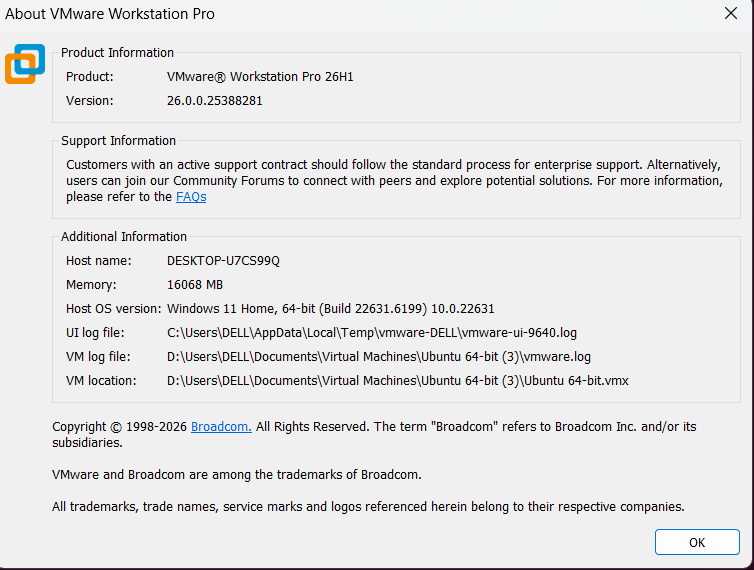
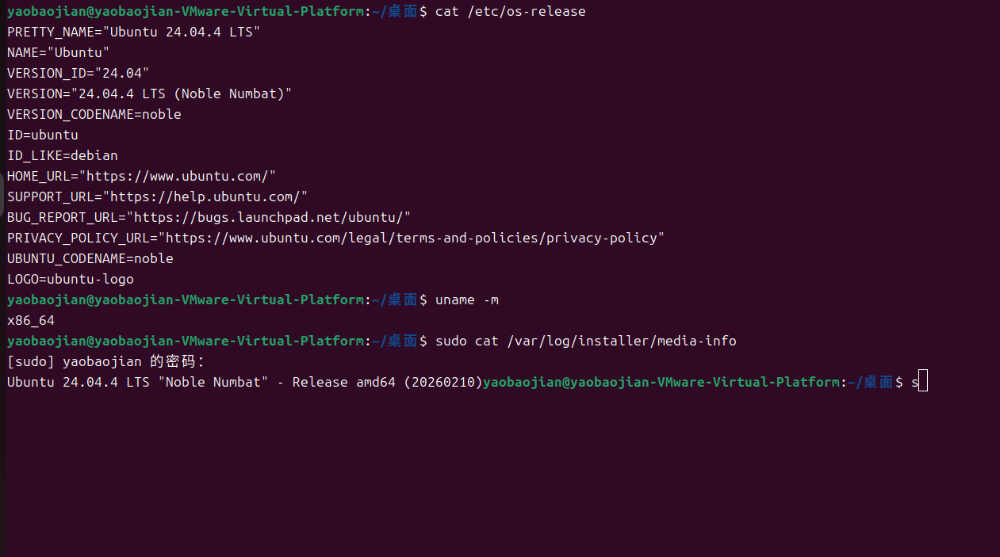
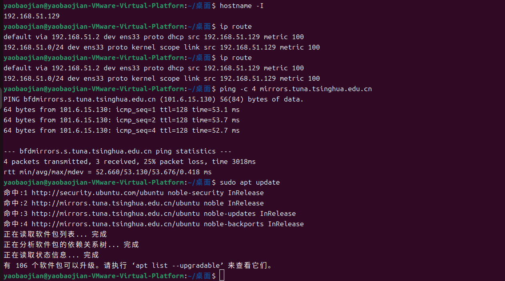
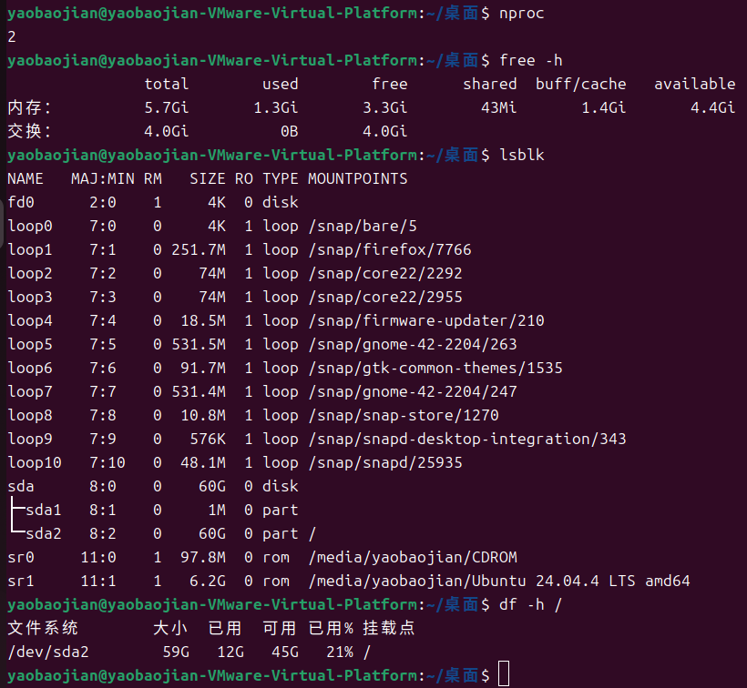
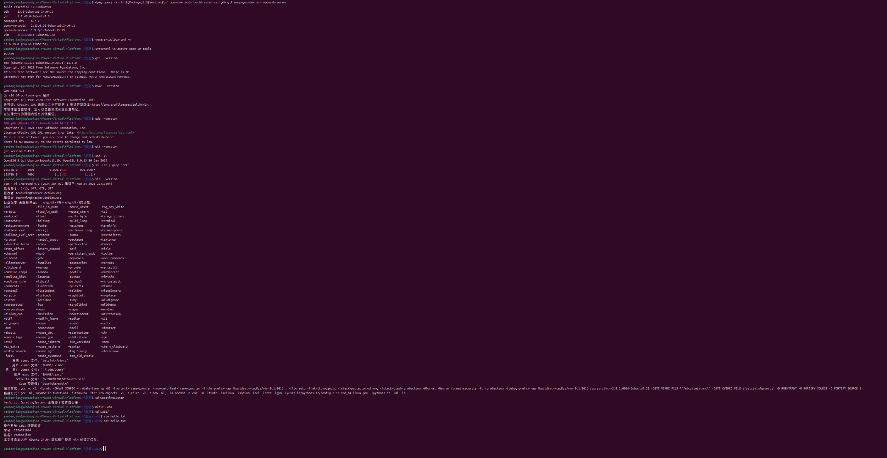

# Lab1：操作系统实验环境验收

> **作业目标**：用命令输出和截图证明 VMware、Ubuntu、网络、虚拟硬件以及课程必需的软件（含终端编辑器 vim 与 SSH 服务端）已正确安装，并能用 vim 完成一次文件的创建与保存。
>
> **前置条件**：已按 [`操作手册.md`](操作手册.md) 完成虚拟机安装和开发工具链配置。软件源用官方源即可，不需要更换。
>
> **命令执行方式**：下面所有命令请**一条一条执行**，每执行一条就先看清它的输出再执行下一条。不要把一节里的命令一次性全部粘贴进终端，否则输出会混在一起，看不出是哪条命令出了问题。

---

## 任务一：检查 VMware 版本

### 第一步：查看版本

在 Windows 中打开 VMware Workstation Pro，在菜单中选择 **Help → About VMware Workstation**，查看版本信息。

教师指定版本为：

```text
VMware Workstation Pro 26H1 for Windows
```

### 第二步：填写检查结果

| 项目 | 你的填写内容 |
| :--- | :--- |
| 已安装的 VMware 完整版本号 |26.0.0.25388281 |
| 是否为教师指定版本 |是 |



---

## 任务二：检查 Ubuntu 版本

### 第一步：查看当前系统版本

```bash
cat /etc/os-release
```

验收标准：`PRETTY_NAME` 中同时包含 `Ubuntu 24.04` 和 `LTS`。安装后执行过系统更新时，小版本可能高于 `24.04.4`，这属于正常现象。

### 第二步：查看处理器架构

```bash
uname -m
```

验收标准：输出为 `x86_64`，对应 amd64 安装镜像。

### 第三步：查看安装介质版本

```bash
sudo cat /var/log/installer/media-info
```

验收标准：输出中包含 `Ubuntu 24.04.4 LTS`，说明安装时使用的是教师提供的 24.04.4 镜像。

### 第四步：填写检查结果

| 项目 | 你的填写内容 |
| :--- | :--- |
| Ubuntu 当前完整版本 |Ubuntu 24.04.4 LTS |
| 安装介质的版本 |Ubuntu 24.04.4 LTS |
| 处理器架构 |x86_64 |
| 是否为教师提供的 Ubuntu 24.04.4 LTS Desktop amd64 |是 |



---

## 任务三：检查虚拟机联网

### 第一步：查看 IP 地址

```bash
hostname -I
```

期望输出一个私有 IP 地址，通常以 `192.168`、`172` 或 `10` 开头。

### 第二步：查看默认路由

```bash
ip route
```

期望能看到一行包含 `default via` 的默认路由，说明虚拟机知道该把外网流量发给哪个网关。

### 第三步：测试 IP 联通性

```bash
ping -c 4 223.5.5.5
```

成功说明虚拟机可以通过 NAT 访问外部网络。

### 第四步：测试 DNS 解析

```bash
ping -c 4 mirrors.tuna.tsinghua.edu.cn
```

成功说明 DNS 解析和域名网络访问正常。

这里只是借一个公网域名验证解析，**不要求你更换软件源**：本实验用官方源也可以，只要第五步的 `sudo apt update` 能正常完成就算合格。

### 第五步：确认软件包索引可以更新

```bash
sudo apt update
```

期望看到若干 `Get:` 行，最后显示读取完成，并且没有 `Err:`、`Failed` 或 `Could not resolve` 之类的错误。

> **软件源用官方源或国内镜像站都可以**，本作业不要求更换软件源，也不会因为 `Get:` 行来自官方源而扣分。只有下载明显缓慢或超时的同学，才需要按操作手册的附录十四换成国内镜像站。
>
> 如果所在网络禁止 ping，但 `sudo apt update` 能正常下载软件索引，可将 `sudo apt update` 的成功输出作为联网证据，并在表格中说明情况。

### 第六步：填写检查结果

| 项目 | 你的填写内容 |
| :--- | :--- |
| 虚拟机 IP 地址 |192.168.51.129 |
| 网络模式 | NAT / 其他： |
| ping `223.5.5.5` 是否成功 |是 |
| ping `mirrors.tuna.tsinghua.edu.cn` 是否成功 |是 |
| 软件源（官方源 / 已换的镜像站） |官方源 |
| `sudo apt update` 是否成功 |是 |
| 联网是否合格 |是 |



---

## 任务四：检查 CPU、内存和存储分配

### 第一步：查看 CPU 核心数

```bash
nproc
```

输出应与安装手册第三节选定的配置档位一致，即 `2` 或 `4`。虚拟机至少应有 2 核。

### 第二步：查看内存

```bash
free -h
```

看 `Mem` 行的 `total` 列。显示的总内存通常会略小于 VMware 中设置的数值，因为一部分内存被固件和内核占用。虚拟机至少应有 4GB 内存。

### 第三步：查看磁盘设备

```bash
lsblk
```

看虚拟磁盘（通常是 `sda` 或 `nvme0n1`）的 `SIZE` 列，应与创建虚拟机时设置的虚磁盘上限一致，即 40GB、60GB 或 80GB。虚拟机至少应有 40GB 虚磁盘。

### 第四步：查看根分区容量

```bash
df -h /
```

看 `Size` 和 `Avail` 列。根文件系统容量可能略小于虚磁盘上限，属于正常现象。

### 第五步：填写检查结果

| 项目 | 你的填写内容 |
| :--- | :--- |
| 宿主机内存 / CPU 核心 / 存放盘剩余空间 |46G |
| 选择的配置档位 | 最低可用档 / 课程推荐档 / 宽裕档 |
| 虚拟 CPU 核心数 |2 |
| 虚拟内存 | 5.7Gi |
| 虚磁盘容量 |60G |
| 根分区可用空间 |59G |
| 资源分配是否符合对应档位 |是 |



---

## 任务五：检查软件安装并用 vim 编写文件

> 本任务只检查软件是否按要求装好，以及能否用 vim 创建并保存文件。第一次实验不编写、不编译 C 程序。

### 第一步：确认软件包已安装

```bash
dpkg-query -W -f='${Package}\t${Version}\n' open-vm-tools build-essential gdb git manpages-dev vim openssh-server
```

期望每行都输出各自的已安装版本号。某一行没有版本号或提示未安装，说明该软件包缺失。

### 第二步：查看 VMware Tools 版本

```bash
vmware-toolbox-cmd -v
```

期望输出一个版本号，例如 `12.x.x.xxxxx (build-xxxxxxx)`。

### 第三步：确认 `open-vm-tools` 服务在运行

```bash
systemctl is-active open-vm-tools
```

期望输出 `active`。

### 第四步：确认 C 工具链已安装

本次实验不编写、不编译程序，但要求把后面实验要用的 C 工具链先装好，所以这里只查版本。依次执行：

```bash
gcc --version
```

```bash
make --version
```

```bash
gdb --version
```

```bash
git --version
```

期望四条命令各输出一行版本信息。任意一条提示 `command not found`，说明对应的软件包没有装上，按 [`操作手册.md`](操作手册.md) 第十一节处理后再重新验证。

### 第五步：确认 SSH 服务端已安装并在监听

```bash
ssh -V
```

期望输出形如 `OpenSSH_9.6p1` 的版本信息。注意这里是大写字母 `V`，查的是 SSH 客户端的版本。

```bash
ss -lnt | grep ':22'
```

期望看到一行包含 `LISTEN` 和 `:22` 的输出。

> Ubuntu 24.04 的 SSH 默认由 `ssh.socket` 按需激活，`systemctl is-active ssh` 显示 `inactive` 属于正常现象，判断标准以 22 端口是否处于监听为准。

### 第六步：确认 vim 可用

```bash
vim --version
```

期望第一行形如 `VIM - Vi IMproved 9.1`。如果提示 `command not found`，或版本行中带 `Small version`（装的是精简版 `vim-tiny`），按 [`操作手册.md`](操作手册.md) 第十一节「问题 2」安装完整版 vim 后再重新验证。

### 第七步：用 vim 创建并保存 hello.txt

进入你建立的实验目录（示例）：

```bash
cd ~/oslab/Lab1
```

用 vim 创建文件：

```bash
vim hello.txt
```

按 `i` 进入编辑模式，输入下面的内容（学号姓名换成自己的），按 `Esc` 退出编辑，再输入 `:wq` 加回车保存并退出：

```text
操作系统 Lab1 环境验收
学号：2026333001
姓名：朱泽科
本文件由本人在 Ubuntu 24.04 虚拟机中使用 vim 创建并保存。
```

回到终端后把文件读回来，确认内容真的写进去了：

```bash
cat hello.txt
```

期望输出与你输入的内容一致，其中学号和姓名是本人的。

> **本作业不需要提交 `hello.txt`**，它只是练 vim 用的练习文件，请留在虚拟机的 `~/oslab/Lab1` 里，不要复制进仓库的提交目录。但截图里必须能看清你用 vim 编辑它的画面和 `cat hello.txt` 的输出——这个步骤能否算通过，就看这张截图。

### 第八步：验证 VMware Tools 桌面功能

用鼠标拖动 VMware 虚拟机窗口的边缘改变窗口大小，观察 Ubuntu 桌面分辨率是否自动调整。

### 第九步：填写检查结果

| 项目 | 你的填写内容 |
| :--- | :--- |
| VMware Tools 版本 |13.0.10.0 (build-25056151) |
| `open-vm-tools` 是否 active |是 |
| 桌面分辨率是否能自动调整 |是 |
| `gcc` 版本 |(Ubuntu 13.3.0-6ubuntu2~24.04.1) 13.3.0 |
| `make` 版本 | Make 4.3 |
| `gdb` 版本 |(Ubuntu 15.1-1ubuntu1~24.04.1) 15.1 |
| `git` 版本 |version 2.43.0 |
| `ssh -V` 的版本信息 |OpenSSH_9.6p1 Ubuntu-3ubuntu13.19 |
| 22 端口是否处于监听 |是 |
| `vim --version` 的版本信息 |VIM - Vi IMproved 9.1 |
| `cat hello.txt` 的输出 |操作系统 Lab1 环境验收
学号：2026333004
姓名：yaobaojian
本文件由本人在 Ubuntu 24.04 虚拟机中使用 vim 创建并保存。
 |
| 软件是否全部安装合格 |是 |



---

## 环境验收总结

| 验收项目 | 合格标准 | 你的结论 |
| :--- | :--- | :--- |
| VMware 版本 | VMware Workstation Pro 26H1 for Windows |是 |
| Linux 版本 | Ubuntu 24.04 LTS Desktop amd64，安装介质为教师提供的 24.04.4 |是 |
| 虚拟机联网 | 具有 IP 和默认路由，IP 联通与 DNS 解析正常 |正常 |
| 软件源 | `sudo apt update` 成功，没有 `Err` 或 `Failed`（使用官方源或国内镜像站均可） |是 |
| CPU、内存、存储 | 至少 2 核、4GB、40GB，且与宿主机档位匹配 |匹配 |
| C 开发工具链 | `gcc`、`make`、`gdb`、`git` 已安装并能输出版本信息（本次不编译程序） |是 |
| vim | `vim --version` 显示完整版，且能用它创建并保存 `hello.txt` |是 |
| OpenSSH Server | `openssh-server` 已安装，`ssh -V` 有版本信息，22 端口处于监听 |是 |
| VMware Tools | 软件包已安装，`open-vm-tools` 为 active，窗口缩放分辨率自动适配 |是 |

简要说明你遇到的问题、解决方法，以及当前环境是否可以继续完成后续实验：

> 填写：

---

## 截图要求

- 截图须清晰，菜单和终端文字可读。
- 终端截图应同时显示完整命令和其输出。
- 一张截图可以包含同一任务下的多条命令及其输出，但每条命令和它的输出必须能对应上。
- 截图中应能看到学生自己的虚拟机、本人学号姓名或本人创建的文件内容，不得直接使用他人截图。
- 必须使用电脑自带的截图功能，严禁使用手机拍摄屏幕。
- 所有截图放在 `imgs/` 目录中，文件名与下表一致。

| 截图内容 | 文件名 |
| :--- | :--- |
| VMware Workstation About 页面，能看到完整版本 | `imgs/lab1_vmware_version.png` |
| Ubuntu 当前版本、安装介质版本和 `x86_64` 架构 | `imgs/lab1_ubuntu_version.png` |
| IP、默认路由、IP ping、域名 ping 和 `apt update` 成功 | `imgs/lab1_network.png` |
| `nproc`、`free -h`、`lsblk`、`df -h /` 输出 | `imgs/lab1_resources.png` |
| 各软件包版本/状态，以及用 vim 创建 `hello.txt` 的画面和 `cat hello.txt` 的输出 | `imgs/lab1_toolchain.png` |

---

## 提交要求

在自己的“学号姓名”文件夹下新建 `Lab1/`，提交填写完整的 `Lab1.md` 和全部 5 张截图：

```text
学号姓名/
└── Lab1/
    ├── Lab1.md
    └── imgs/
        ├── lab1_vmware_version.png
        ├── lab1_ubuntu_version.png
        ├── lab1_network.png
        ├── lab1_resources.png
        └── lab1_toolchain.png
```

> **注意**：`imgs` 全部小写；文件夹名和截图文件名区分大小写，必须与上面完全一致，否则图片引用会失效。
> 文件名里的分隔符是**下划线 `_`**，不是减号 `-`：要写 `lab1_vmware_version.png`，不要写成 `lab1-vmware-version.png`。
>
> **只提交上面列出的文件。** 本作业只有 `Lab1.md` 和 5 张截图，不需要提交任何代码或文档：练习用的 `hello.txt` 请留在虚拟机的 `~/oslab/Lab1` 里，不要复制进仓库。提交前用 `git status` 确认变更文件只有上面这 6 个。

---

## 截止时间

**2026 年 10 月 8 日 23:59:59**

按仓库 `README.md` 第 4 节的规则：不晚于 10 月 8 日 23:59:59 创建 PR 并完成最后一次推送不算超时，10 月 9 日 00:00 起新建 PR 或向已有 PR 推送任何修改均算作超时。时间按北京时间计算，并以 GitHub 记录的最后一次推送时间为准。审核未通过的同学请务必在截止前完成修改。
