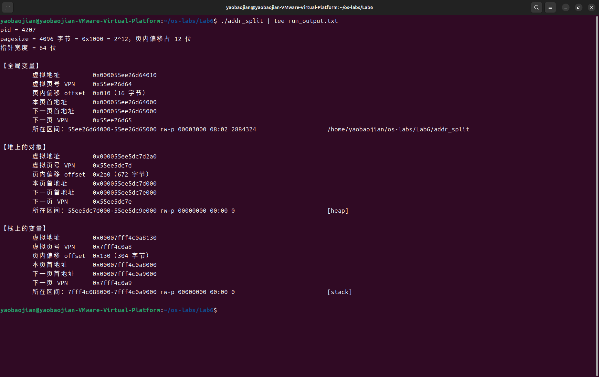

# Lab6：虚拟地址分解与观测

虚拟地址可以按页大小分解为虚拟页号与页内偏移。本实验使用 `addr_split.c` 输出全局变量、堆对象和栈变量的地址，观察地址分解结果，并将对象地址与 Linux 的内存映射区间对应起来。

> **实验目标**：识别虚拟地址、虚拟页号和页内偏移；根据程序输出核对页内偏移范围及页边界关系；理解对象所在页与 maps 映射区间的区别。
>
> **实验范围**：唯一必做内容为“虚拟地址分解与观测”。目录准备、源码传输、编译和截图均属于该实验的操作步骤。页表转换、页驻留状态与 TLB 仅作为文末选读，不要求执行或作答。
>
> **执行环境**：使用 Lab1 至 Lab4 的 Ubuntu 虚拟机。程序由仓库提供，无需自行编写；全部编译和运行操作均在 Ubuntu 中完成。
>
> **提交材料**：填写完成的 `Lab6.md` 与一张运行截图 `imgs/lab6_split.png`。
>
> **执行要求**：命令逐条执行，每次检查输出后再继续。下文分别标注“本机”和“Ubuntu”，避免将本机仓库与虚拟机实验目录混用。

## 一、地址分解的基本关系

### 1.1 虚拟页号与页内偏移

虚拟地址空间按固定大小划分为页，各页从 0 开始编号。一个虚拟地址由以下两部分确定：

| 名称 | 记号 | 含义 |
| :--- | :--- | :--- |
| 虚拟页号 | VPN | 标识该地址属于哪个虚拟页 |
| 页内偏移 | offset | 该地址相对于所属页起始地址的字节距离 |

设虚拟地址为 `addr`，页大小为 `ps`：

```text
VPN    = addr ÷ ps 的整数商
offset = addr 除以 ps 的余数
addr   = VPN × ps + offset
```

例如，页大小为 4096 字节，虚拟地址为 4102：

```text
4102 = 1 × 4096 + 6
VPN = 1，offset = 6
```

这表示地址 4102 属于虚拟页 1，距离该页起始地址 6 字节。

### 1.2 页边界

4 KiB 等于 4096 字节。采用该页大小时，前三个虚拟页的地址范围如下，区间两端均包含在内：

| VPN | 虚拟地址范围（十进制） |
| :---: | :--- |
| 0 | 0～4095 |
| 1 | 4096～8191 |
| 2 | 8192～12287 |

余数小于除数，因此页内偏移满足：

```text
0 ≤ offset < ps
```

4 KiB 页的偏移范围是 0～4095。由于 `4096 = 2¹²`，偏移占 12 个二进制位。程序会自动显示本机页大小与偏移位数，无需手工拆解二进制地址。

地址增加 1 时，是否跨页取决于原偏移：

- 原偏移小于 `ps − 1`：VPN 不变，偏移增加 1。
- 原偏移等于 `ps − 1`：VPN 增加 1，偏移变为 0。

例如，地址 4095 的 VPN 为 0、偏移为 4095；地址 4096 的 VPN 为 1、偏移为 0。以下两个公式用于定位当前页与下一页的起点：

```text
本页首地址   = addr − offset
下一页首地址 = 本页首地址 + ps
```

### 1.3 页与内存映射区间

Lab4 中的 `/proc/PID/maps` 描述进程的虚拟内存映射。一条映射记录可以覆盖多个连续虚拟页，因此“映射区间起点”与“对象所在页的首地址”不一定相同。

```text
映射区间起点 ≤ 对象虚拟地址 < 映射区间终点
```

maps 区间包含左端、不包含右端。本实验的程序会自动查找对象所属区间，无需另开终端查询 PID。程序输出的对象地址、页首地址与 maps 区间地址均为虚拟地址。

## 二、实验步骤：虚拟地址分解与观测

### 步骤 1：建立本机报告目录

**执行位置：本机，即保存课程仓库的 Windows 或 macOS。**

在文件资源管理器或 VS Code 中打开课程仓库，完成以下操作：

1. 在本人“10 位学号＋姓名”目录中创建 `Lab6` 文件夹。
2. 在该文件夹中创建小写的 `imgs` 文件夹。
3. 将 `homework/Lab6/Lab6.md` 复制到本人 `Lab6` 文件夹，保留文件名 `Lab6.md`。
4. 打开复制后的文件，后续实验记录填写在此文件中。

两个目录的用途如下：

| 目录 | 位置 | 内容 |
| :--- | :--- | :--- |
| `学号姓名/Lab6/` | 本机仓库 | 报告与截图，用于提交 |
| `~/os-labs/Lab6/` | Ubuntu 虚拟机 | 源码与可执行文件，用于运行 |

Windows 隐藏扩展名时，应检查报告文件没有被保存为 `Lab6.md.txt`。教师目录 `homework/Lab6/` 中的文件作为模板与源码使用，学生提交时不修改该目录。

### 步骤 2：建立 Ubuntu 实验目录

**执行位置：Ubuntu 终端。** 可在 Ubuntu 桌面按 `Ctrl+Alt+T` 打开终端。

```bash
mkdir -p ~/os-labs/Lab6
```

`~` 表示当前用户的主目录；`mkdir -p` 创建所需目录，目录已经存在时不重复创建。

```bash
cd ~/os-labs/Lab6
```

```bash
pwd
```

`pwd` 应显示类似 `/home/student/os-labs/Lab6` 的路径，其中 `student` 应为实际用户名。记录该完整路径，后续编译与运行都在此目录完成。

继续查询用户名和 IP，供下一步传输源码使用：

```bash
whoami
```

```bash
hostname -I
```

记录 `whoami` 输出的用户名，以及宿主机能够访问的虚拟机 IP。若输出多个地址，可使用 Lab2 已验证可用于 SSH 连接的地址。

### 步骤 3：传输源码

以下两种方式任选一种。源文件为本机仓库中的 `homework/Lab6/addr_split.c`。

#### 方式 A：scp 传输

**执行位置：本机终端，不是 Ubuntu 终端。** Windows 可使用 PowerShell，macOS 可使用终端。

先进入本机课程仓库根目录，即包含 `homework` 与 `README.md` 的目录。下面的路径应替换为实际路径；路径含空格时保留双引号：

```bash
cd "课程仓库的完整路径"
```

将用户名与 IP 替换为步骤 2 的实际结果后执行：

```bash
scp homework/Lab6/addr_split.c Ubuntu用户名@虚拟机IP:~/os-labs/Lab6/
```

例如，用户名为 `student`、IP 为 `192.168.10.128` 时，命令形式为：

```bash
scp homework/Lab6/addr_split.c student@192.168.10.128:~/os-labs/Lab6/
```

示例用户名和 IP 仅说明格式，不能直接作为本机连接参数。Windows PowerShell 的源路径也可写为 `.\homework\Lab6\addr_split.c`。

首次连接可能要求确认目标主机，核对为本人虚拟机后输入 `yes`。随后输入 Ubuntu 登录密码；密码输入时终端通常不显示字符。传输结束后返回本机命令提示符。

#### 方式 B：VS Code Remote-SSH

1. 在本机 VS Code 中使用 Lab2 已配置的 Remote-SSH 连接 Ubuntu，确认左下角显示 `SSH: ...`。
2. 选择 `File → Open Folder...`，输入步骤 2 中 `pwd` 显示的完整路径。
3. 在远程目录中创建 `addr_split.c`。
4. 在本机仓库打开 `homework/Lab6/addr_split.c`，复制文件的全部内容，粘贴到远程同名文件并保存。只复制 C 源码，不添加 Markdown 的代码围栏。
5. 选择 `Terminal → New Terminal`。该终端运行于 Ubuntu，可用于后续操作。

### 步骤 4：核对目录与源码

**执行位置：Ubuntu 终端。** 使用 scp 的学生返回 Ubuntu 终端；使用 Remote-SSH 的学生使用远程集成终端。

```bash
cd ~/os-labs/Lab6
```

```bash
pwd
```

```bash
ls -l addr_split.c
```

最后一条命令应列出 `addr_split.c`，文件大小应大于 0。若提示 `No such file or directory`，说明当前目录或传输位置不正确，应返回步骤 3 核对，暂不编译。

查看源码：

```bash
cat addr_split.c
```

源码应包含 `#include`、`show_region`、`show` 和 `main` 等内容，末尾为完整的右花括号。程序使用的三个对象如下：

| 对象 | 源码中的定义或分配 | 观察目的 |
| :--- | :--- | :--- |
| 全局变量 | `int global_var = 1;` | 观察程序数据映射中的地址 |
| 堆上的对象 | `malloc(sizeof(int))` | 观察动态分配对象的地址 |
| 栈上的变量 | `int stack_var = 2;` | 观察栈区域中的地址 |

本实验仅需理解以下三个运算。`addr` 表示虚拟地址，`ps` 表示页大小；C 的整数除法 `/` 取商，`%` 取余数。

```c
unsigned long vpn = addr / ps;
unsigned long offset = addr % ps;
unsigned long page_base = addr - offset;
```

程序中的文件读取、循环与内存分配已实现，不要求修改源码或逐行解释这些实现。

### 步骤 5：编译并检查状态

**执行位置：Ubuntu 的 `~/os-labs/Lab6/`。**

```bash
gcc -O0 -o addr_split addr_split.c
```

| 命令部分 | 含义 |
| :--- | :--- |
| `gcc` | 调用 C 编译器 |
| `-O0` | 关闭编译优化；大写字母 O 后为数字 0 |
| `-o addr_split` | 指定可执行文件名；这里是小写字母 o |
| `addr_split.c` | 输入源码文件 |

编译后立即执行：

```bash
echo $?
```

`$?` 表示上一条命令的退出状态。编译成功应为 `0`；中间插入其他命令会改变这一状态的含义。

确认成功后检查可执行文件：

```bash
ls -l addr_split
```

应列出名为 `addr_split` 的文件，其权限列通常包含 `x`。若编译失败，先根据首条报错修正问题，再重新编译；不使用旧的可执行文件代替本次编译结果。

### 步骤 6：运行并保留输出

**执行位置：同一 Ubuntu 终端。**

```bash
./addr_split
```

`./` 表示执行当前目录中的程序。程序依次输出页大小、指针宽度及三个对象的观测结果，然后自动退出，无需输入或等待回车。

运行结束后立即执行：

```bash
echo $?
```

正常退出状态应为 `0`。保留本次输出，后续表格与截图统一使用这次运行的数据。重新运行时地址可能变化，不应混合不同运行的记录。

### 步骤 7：按字段读取输出

以下内容仅为**教学示例**，用于说明格式和读取方法，不作为学生实测记录：

```text
pid = 5312
pagesize = 4096 字节 = 2^12，因此页内偏移占 12 位
指针宽度 = 64 位

【全局变量】
         地址             0x000055d0a1b2c010
         页号 VPN         23035779884
         页内偏移 offset  16
         本页首地址       0x000055d0a1b2c000
         地址 +1 的页号    23035779884（仍在同一页）
         下一页首地址     0x000055d0a1b2d000，页号 23035779885
         所在区间：55d0a1b2c000-55d0a1b2d000 rw-p 00001000 08:01 1234567 /home/student/os-labs/Lab6/addr_split

【堆上的对象】
         地址             0x000055d0a3e4f2a0
         页号 VPN         23035788879
         页内偏移 offset  672
         本页首地址       0x000055d0a3e4f000
         地址 +1 的页号    23035788879（仍在同一页）
         下一页首地址     0x000055d0a3e50000，页号 23035788880
         所在区间：55d0a3e4f000-55d0a3e70000 rw-p 00000000 00:00 0 [heap]

【栈上的变量】
         地址             0x00007ffd3c2a4b2c
         页号 VPN         34356839076
         页内偏移 offset  2860
         本页首地址       0x00007ffd3c2a4000
         地址 +1 的页号    34356839076（仍在同一页）
         下一页首地址     0x00007ffd3c2a5000，页号 34356839077
         所在区间：7ffd3c286000-7ffd3c2a7000 rw-p 00000000 00:00 0 [stack]
```

以上示例包含程序输出的环境信息和三个对象的完整记录。各段字段顺序相同，按以下顺序阅读：

1. **读取页大小。** `pagesize` 后的数值是后续判断使用的 `ps`。示例为 4096 字节，实际记录采用本人输出。
2. **区分地址与值。** “地址”一行是对象的虚拟地址，不是变量中保存的 1、2 或 3；以 `0x` 开头表示十六进制。
3. **读取 VPN 与偏移。** 两行均为十进制数。示例中三个偏移分别为 16、672、2860，均满足 `0 ≤ offset < 4096`。完整地址可以原样复制，无需手工转换为十进制。
4. **核对页边界。** 示例全局变量的下一页 VPN 为 `23035779885`，比当前 VPN `23035779884` 大 1；堆对象和栈变量也满足这一关系。三个对象的“地址 +1”仍在同一页，是因为原偏移均未达到页末；不能据此推断所有地址增加 1 都不跨页。
5. **识别映射区间。** “所在区间”由程序自动匹配，不需要在 maps 中搜索变量名。全局变量通常对应 `addr_split` 文件的可写映射，堆对象通常对应 `[heap]`，栈变量通常对应 `[stack]`；具体路径与标签以实际输出为准。

示例全局变量的地址减去偏移 16，即得到本页首地址 `0x000055d0a1b2c000`，其映射区间恰好也从此处开始。栈变量所在页的首地址为 `0x00007ffd3c2a4000`，而栈映射区间从 `0x00007ffd3c286000` 开始，说明一个映射区间可以包含多个页，区间起点与对象所在页的首地址不一定相同。

maps 中的地址通常不带 `0x`，与程序打印地址的数值表示一致。权限串 `rw-p` 分别表示可读、可写、不可执行、私有映射。设备号、inode 和文件偏移仅作输出信息保留，本次不要求解释。

### 步骤 8：填写实验记录并核对

在步骤 1 创建的本机报告中填写以下表格。

**运行信息：**

| 项目 | 本人实测结果 |
| :--- | :--- |
| Ubuntu 实验目录完整路径（步骤 2 或 4 的 `pwd` 输出） | `/home/yaobaojian/os-labs/Lab6` |
| 编译退出状态（步骤 5 的 `echo $?`） | 0 |
| 运行退出状态（步骤 6 的 `echo $?`） | 0 |
| 页大小，单位为字节（`pagesize`） | 4096 |

**地址分解结果：填写方法**

表格的一行对应一个对象，三个数据列分别对应程序输出中的三个字段。按以下步骤填写。

**1. 确定输出段与表格行的对应关系。**

- `【全局变量】` 下的字段填写到“全局变量”行。
- `【堆上的对象】` 下的字段填写到“堆上的对象”行。
- `【栈上的变量】` 下的字段填写到“栈上的变量”行。

每段从对象名称开始，到下一个对象名称之前结束。填写某一行时，三个数值必须取自同一段输出。

**2. 按列提取字段。** 以步骤 7 的全局变量教学示例为例：

| 报告中的列 | 对应的输出行 | 该列填写内容 | 填写要求 |
| :--- | :--- | :--- | :--- |
| 完整虚拟地址 | `地址 0x000055d0a1b2c010` | `0x000055d0a1b2c010` | 保留完整地址及 `0x` 前缀，不填“本页首地址”或 maps 区间起点 |
| 页号 VPN | `页号 VPN 23035779884` | `23035779884` | 复制当前对象的页号，不填“地址 +1 的页号”或“下一页首地址”后的页号 |
| 页内偏移 offset | `页内偏移 offset 16` | `16` | 复制偏移数值，不填页大小 `4096` 或偏移位数 `12` |

记录字段右侧的数值即可。虚拟地址来自对象对应的“地址”行；VPN 与 offset 是程序根据该地址和 `pagesize` 计算的结果，其计算方法如下。

**3. 根据地址与页大小计算 VPN 和偏移。**

从输出顶部的 `pagesize` 获取页大小 `ps`，从当前对象的“地址”行获取虚拟地址 `addr`。计算关系为：

```text
VPN    = addr ÷ ps 的整数商
offset = addr − VPN × ps
```

其中 offset 也是 `addr` 除以 `ps` 的余数。计算后用 `VPN × ps + offset = addr` 核对，并检查 `0 ≤ offset < ps`。

对于示例中的 4096 字节页，`4096 = 0x1000 = 2¹²`，恰好对应三位十六进制数字。因此，可将地址的末三位作为偏移，其余高位作为 VPN：

```text
全局变量虚拟地址：0x000055d0a1b2c010

VPN 的十六进制表示：0x000055d0a1b2c
VPN 的十进制表示：  23035779884

offset 的十六进制表示：0x010
offset 的十进制表示：  16

核对：23035779884 × 4096 + 16 = 0x000055d0a1b2c010
```

十六进制与十进制之间的转换可使用计算器的程序员模式。其余两个示例对象的偏移计算为：

- 堆对象地址末三位为 `2a0`：`0x2a0 = 2 × 16² + 10 × 16 = 672`。
- 栈变量地址末三位为 `b2c`：`0xb2c = 11 × 16² + 2 × 16 + 12 = 2860`。

“末三位为偏移”仅适用于 4096 字节页。实测页大小不同时，应采用通用的整数除法与取余公式。报告可直接记录程序输出的计算结果，上述方法用于理解和核对数值来源。

**4. 对照完整填写示例。** 根据步骤 7 的三段教学输出，填写结果如下。此表仅用于展示对应关系，学生实测数据填写在后面的空表中。

| 对象 | 完整虚拟地址 | 页号 VPN | 页内偏移 offset |
| :--- | :--- | :--- | :--- |
| 全局变量 | `0x000055d0a1b2c010` | 23035779884 | 16 |
| 堆上的对象 | `0x000055d0a3e4f2a0` | 23035788879 | 672 |
| 栈上的变量 | `0x00007ffd3c2a4b2c` | 34356839076 | 2860 |

**地址分解结果：本人实测记录**

下表是需要填写的记录表。三个对象的数据均取自本人同一次运行，不使用上面的教学示例数值代替实测结果。

| 对象 | 完整虚拟地址 | 页号 VPN | 页内偏移 offset |
| :--- | :--- | :--- | :--- |
| 全局变量 | `0x000055ee26d64010` | 0x55ee26d64（十进制 23066733924） | 0x010（16 字节） |
| 堆上的对象 | `0x000055ee5dc7d2a0` | 0x55ee5dc7d（十进制 23066958973） | 0x2a0（672 字节） |
| 栈上的变量 | `0x00007fff4c0a8130` | 0x7fff4c0a8（十进制 34359001256） | 0x130（304 字节） |

**结果核对：**使用本次输出完成以下两项，不要求计算物理地址或不同对象之间的地址距离。

| 核对项目 | 结果与依据 |
| :--- | :--- |
| 三个对象的偏移是否均在 `0 ≤ offset < ps` 范围内 | 是。页大小 ps = 4096 字节，偏移允许范围为 0～4095；三个实测偏移为 0x010（16 字节）、0x2a0（672 字节）、0x130（304 字节），均在范围内。 |
| 全局变量的“下一页首地址”对应 VPN 是否等于当前 VPN 加 1 | 是。当前 VPN = 0x55ee26d64（十进制 23066733924），“下一页首地址”对应的 VPN = 0x55ee26d65（十进制 23066733925），恰为当前 VPN 加 1。 |

核对方法：页大小为 `ps` 时，偏移允许范围为 `0～ps−1`；第二项只比较程序已经打印的两个十进制页号，无需计算长十六进制地址。若不符合关系，先核对是否抄错字段或混用了两次运行，保留实际结果并注明原因。

其他输出仅用于阅读与截图，不要求另抄映射区间、指针宽度或填写额外分析题。

### 步骤 9：保存运行截图

截图文件名为 `imgs/lab6_split.png`，保存于本机报告同级的 `imgs` 文件夹。

1. 调整 Ubuntu 终端或 VS Code 远程终端的窗口尺寸，使运行命令、页大小和三个对象的输出完整可见。
2. 使用电脑截图功能截取终端内容。Windows 可使用 `Win+Shift+S`，macOS 可使用 `Shift+Command+4`。
3. 若单个窗口无法容纳全部输出，可分段截取**同一次运行**的输出并拼成一张图；保留命令及完整字段，不混入另一次运行的数据，不修改输出文字。
4. 将图片保存或导出为真正的 PNG 文件，命名为 `lab6_split.png`。不通过修改扩展名将其他图片格式伪装为 PNG。
5. 在本机 VS Code 中打开已填写的 `Lab6.md`，使用 Markdown 预览确认下方图片可见且文字清晰。

截图必须包含 `./addr_split` 命令、`pagesize`，以及全局变量、堆对象、栈变量的完整输出，各段均应包含“所在区间”。编译与运行退出状态填写在报告中，不强制要求出现在截图里。



## 三、故障排查

| 现象 | 检查与处理 |
| :--- | :--- |
| scp 提示连接被拒绝或超时 | 在 Ubuntu 重新执行 `hostname -I` 核对 IP；执行 `ss -lnt` 检查是否存在监听 22 端口的记录，按 Lab1 的 SSH 配置处理 |
| scp 提示 `Permission denied` | 使用 Ubuntu 的 `whoami` 核对用户名；使用 Ubuntu 登录密码，不使用本机系统密码 |
| scp 提示源文件不存在 | 确认本机终端位于课程仓库根目录，源文件路径为 `homework/Lab6/addr_split.c` |
| Ubuntu 找不到 addr_split.c | 使用 `pwd` 和 `ls` 核对当前目录；确认源码已保存到 `~/os-labs/Lab6/` |
| `gcc: command not found` | 在 Ubuntu 依次执行 `sudo apt update`、`sudo apt install build-essential`，完成后重新编译 |
| 编译报告语法错误 | 阅读首条报错，核对源码是否复制完整、是否误加 Markdown 代码围栏 |
| 执行 addr_split 提示找不到命令 | 使用 `./addr_split`，并确认步骤 5 编译成功且生成文件 |
| 提示无法读取 /proc/self/maps | 确认运行位置为 Ubuntu；Windows Git Bash 和 macOS 本机终端不能代替该环境，真实读取错误应保留说明 |
| 两次运行地址不同 | 地址随进程运行可能变化；选择一次完整运行填写表格并截图 |
| 页大小不是 4096 | 所有实测核对均使用本机 `pagesize`，不强行替换为教学示例值 |
| 中文输出乱码或方框 | 源码与终端使用 UTF-8，终端选择支持中文的字体 |
| 图片在 Markdown 中不显示 | 核对 `imgs/lab6_split.png` 的相对位置、大小写、扩展名与下划线 |

## 四、选读：地址分解之后的机制

本节仅提供知识衔接，不要求运行程序、填写答案或提交截图。

### 4.1 页表与物理地址

地址分解得到 VPN 与偏移，但尚未确定物理地址。页表记录虚拟页与物理页框的对应关系。在目标页已驻留且访问权限满足要求时，根据页表取得页框号 PFN，再构造物理地址：

```text
物理地址 = PFN × 页大小 + 页内偏移
```

转换前后的偏移保持不变。连续的虚拟页可以映射到不连续的物理页框。`addr_split` 未读取 PFN，因此其输出不能直接确定物理地址。

### 4.2 页的驻留状态

建立虚拟地址映射与分配驻留物理页可以发生在不同时间。匿名页首次写入时，内核可通过缺页处理分配物理页并建立可写映射。

仓库中的 `pte_dump.c` 展示首次写入前后的页状态，使用 `/proc/self/pagemap` 接口。pagemap 为内核导出格式，不是原始硬件页表项。PFN 的可见性受权限限制，读取到 0 不一定表示页未驻留。

### 4.3 TLB 与跨页访问

TLB 缓存地址转换结果。命中时可以复用转换；在课程使用的 x86-64 环境中，未命中时通常由硬件查询页表。TLB 未命中不等于缺页，目标页仍可能已经驻留且具有可用映射。

仓库中的 `tlb_probe.c` 用于观察工作集增大时的跨页访问耗时。耗时同时受到 TLB、数据缓存及虚拟机调度等因素影响，不能从曲线直接确定 TLB 容量。该程序与 `pte_dump.c` 均不属于本次操作要求。

## 五、提交要求

提交目录包含以下两个文件：

```text
学号姓名/
└── Lab6/
    ├── Lab6.md
    └── imgs/
        └── lab6_split.png
```

提交前核对：

- 步骤 8 的运行信息、三个对象的地址分解结果及两项核对均已填写。
- 报告采用本人实测数据，与步骤 9 的截图对应同一次运行。
- 图片在 Markdown 预览中显示正常，命令与输出清晰可读，未使用手机拍屏或他人截图。
- 报告保留模板正文、表格与图片引用，选读不要求作答。
- 源码、可执行文件与其他运行材料留在 Ubuntu 实验目录，不增加提交文件。

在本机仓库根目录检查工作区变更：

```bash
git status --short
```

按照仓库 README 暂存本人文件后，检查暂存范围：

```bash
git diff --cached --name-only
```

按照 README 同步上游后，检查本分支相对教师版本的改动：

```bash
git diff --name-status upstream/main
```

本次提交范围应限定为本人 Lab6 的上述两个文件。其他作业或越界修改按 README 处理，已经提交的历史作业应保留。PR 标题为：

```text
[学号姓名]Lab6作业提交
```

右方括号与 Lab6 之间不含空格，其余流程按仓库根目录 README 执行。

## 六、截止时间

**2026 年 11 月 16 日 23:59:59（北京时间）**

按仓库 `README.md` 第 4 节的规则，PR 创建与最后一次推送均需不晚于上述时间。11 月 17 日 00:00 起新建 PR 或向已有 PR 推送修改均计为超时；审核未通过时，也应在截止前完成修改与推送。
